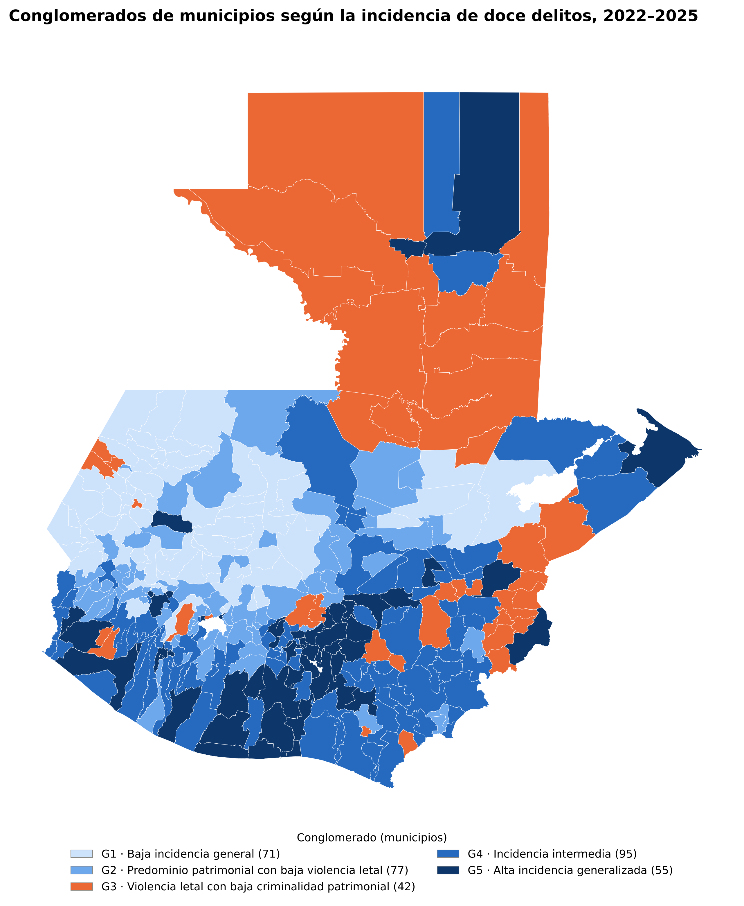
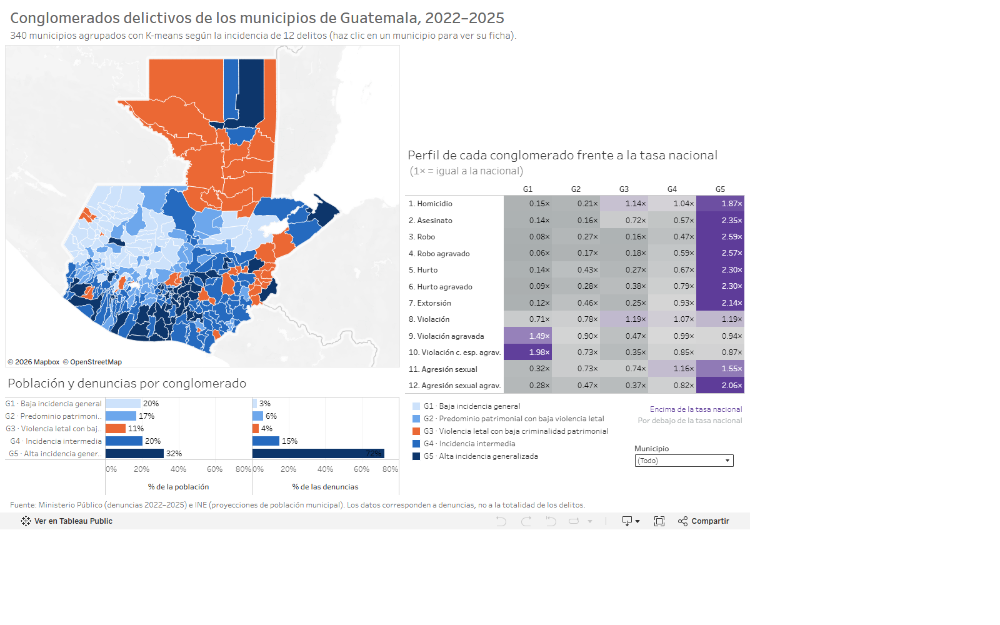

<div align="center">

# Agrupamiento de municipios según la incidencia de doce delitos en Guatemala

**Aprendizaje no supervisado aplicado a las denuncias del Ministerio Público, 2022–2025**


Trabajo de graduación · Ingeniería en Ciencia de la Computación y Tecnologías de la Información · Universidad del Valle de Guatemala

**[Ver el tablero interactivo en Tableau Public](https://public.tableau.com/app/profile/michelle.villela/viz/DashboardIncidenciaCriminal/Dashboard2)**

</div>

---

## Contenido

- [Descripción](#descripción)
- [Tecnologías utilizadas](#tecnologías-utilizadas)
- [Requisitos previos](#requisitos-previos)
- [Instalación](#instalación)
- [Ejecución](#ejecución)
- [Estructura del repositorio](#estructura-del-repositorio)
- [Resultados](#resultados)
- [Datos](#datos)
- [Capturas](#capturas)
- [Demo](#demo)
- [Documentación](#documentación)
- [Limitaciones y uso responsable](#limitaciones-y-uso-responsable)
- [Autora](#autora)
- [Licencia](#licencia)

---

## Descripción

¿Qué municipios de Guatemala tienen perfiles delictivos parecidos? Este proyecto responde esa pregunta con algoritmos de aprendizaje no supervisado aplicados a los **340 municipios** del país y a las denuncias de **doce delitos** registradas por el Ministerio Público entre 2022 y 2025:

> homicidio · asesinato · robo · robo agravado · hurto · hurto agravado · extorsión · violación · violación agravada · violación con circunstancias especiales de agravación · agresión sexual · agresión sexual con agravación de la pena

Las denuncias se convierten en tasas por cada 100,000 habitantes, se estabilizan con un suavizado bayesiano empírico y se agrupan con **K-means**, elegido tras compararlo con un modelo de mezclas gaussianas (GMM) y el agrupamiento espectral. Los cinco conglomerados resultantes se caracterizan, se validan en el territorio y se publican en un tablero interactivo de Tableau Public.

> [!NOTE]
> Los datos son **denuncias registradas**, no la totalidad de los delitos ocurridos. Los conglomerados describen patrones de denuncia y no son etiquetas de peligrosidad de los municipios ni de su población.

---

## Tecnologías utilizadas

- **Python** (3.10 o superior; desarrollado con 3.14.3)
- **pandas** y **NumPy**: integración y transformación de datos
- **SciPy**: pruebas estadísticas
- **scikit-learn**: K-means, modelo de mezclas gaussianas, agrupamiento espectral y métricas
- **Matplotlib**: figuras
- **openpyxl**: lectura de las proyecciones de población en Excel
- **Jupyter Notebook**: los ocho cuadernos del análisis
- **Tableau Public**: tablero interactivo

---

## Requisitos previos

- Python 3.10 o superior
- pip
- Jupyter Notebook o JupyterLab (se instala con `requirements.txt`)
- Git (para clonar el repositorio)
- Navegador web para abrir el tablero de Tableau Public

El proyecto **no usa base de datos ni credenciales**. El archivo [`src/.env.example`](src/.env.example) se incluye por requisito de la entrega y explica que no hace falta configurar variables de entorno.

---

## Instalación

1. Clonar el repositorio:

   ```bash
   git clone https://github.com/michellemej22596/2026-22596-mejia-villela-michelle-angel-de-maria.git
   cd 2026-22596-mejia-villela-michelle-angel-de-maria/src
   ```

2. (Opcional) Crear y activar un entorno virtual:

   ```bash
   python -m venv .venv
   # Windows
   .venv\Scripts\activate
   # macOS / Linux
   source .venv/bin/activate
   ```

3. Instalar las dependencias:

   ```bash
   pip install -r requirements.txt
   ```

4. Variables de entorno: no se requieren. Si se desea, copiar el ejemplo:

   ```bash
   cp .env.example .env
   ```

---

## Ejecución

Desde la carpeta `src/`:

```bash
jupyter notebook
```

Ejecute los cuadernos en orden. Cada uno lee los resultados del anterior, y las decisiones de cada etapa se guardan en `src/outputs/reports/`.

| Cuaderno | Contenido |
| --- | --- |
| `notebooks/exploratory/01_EDA_denuncias_MP` | Calidad, distribución y concentración de las denuncias |
| `notebooks/exploratory/02_EDA_poblacion_INE` | Reestructuración y análisis de las proyecciones de población |
| `notebooks/exploratory/03_EDA_integrado_tasas` | Integración de fuentes, tasas, ruido y tendencia al agrupamiento |
| `notebooks/preprocessing/04_preprocesamiento` | Suavizado, transformación, escalado y representaciones |
| `notebooks/modeling/05_exploracion_algoritmos` | Pruebas de algoritmos y tratamiento de los delitos de baja frecuencia |
| `notebooks/modeling/06_comparacion_modelos` | Comparación de K-means, GMM y agrupamiento espectral |
| `notebooks/modeling/07_optimizacion` | Hiperparámetros, sensibilidad y elección de k |
| `notebooks/modeling/08_caracterizacion` | Perfiles, nombres, evolución, mapas, validación espacial y exportación a Tableau |

Los cuadernos localizan solos la carpeta del proyecto (`src/`), así que pueden abrirse desde cualquier subcarpeta. Los procesos aleatorios usan la semilla 42.

**Control:** al terminar, `src/data/processed/resultado_agrupamiento.csv` debe tener 340 municipios, con 71, 77, 42, 95 y 55 municipios en G1 a G5.

**Tablero:** no requiere instalación; se abre en [Tableau Public](https://public.tableau.com/app/profile/michelle.villela/viz/DashboardIncidenciaCriminal/Dashboard2). Sus datos se generan en `src/outputs/tableau/`.

---

## Estructura del repositorio

```text
.
├── capturas/                 # 14 capturas del software en funcionamiento
├── demo/
│   └── demo.mp4              # Video demostrativo
├── docs/
│   ├── informe_final.pdf     # Informe final del trabajo de graduación
│   ├── consentimiento_firmado.pdf
│   └── anexos/               # Protocolo del trabajo de graduación
├── src/                      # Código fuente y datos del proyecto
│   ├── .env.example
│   ├── requirements.txt
│   ├── src/                  # Módulos de Python reutilizados por los cuadernos
│   │   ├── preprocesamiento.py   # Suavizado bayesiano empírico y transformaciones
│   │   ├── modelos.py            # Métricas, estabilidad bootstrap, gap y Jaccard
│   │   └── utilidades.py         # Rutas, catálogos de delitos, colores y estilo de figuras
│   ├── notebooks/
│   │   ├── exploratory/      # 01–03: análisis exploratorio e integración
│   │   ├── preprocessing/    # 04: suavizado, transformación y representaciones
│   │   └── modeling/         # 05–08: algoritmos, comparación, optimización y caracterización
│   ├── data/
│   │   ├── raw/              # Datos originales (Ministerio Público, INE e IGN)
│   │   ├── processed/        # Bases integradas, tasas, matrices y resultado del agrupamiento
│   │   └── external/         # Capa geográfica con códigos del INE
│   └── outputs/
│       ├── figures/          # Figuras de cada cuaderno
│       ├── reports/          # Decisiones y métricas de cada etapa (CSV y JSON)
│       └── tableau/          # Datos del tablero
├── .gitignore
├── LICENSE
└── README.md
```

---

## Resultados

Los municipios forman un **continuo de incidencia** y no grupos aislados. La partición en cinco conglomerados es una segmentación estable de ese continuo, que se distingue en dos ejes: **criminalidad patrimonial y extorsiva** y **violencia letal**.

<div align="center">

</div>

| | Conglomerado | Municipios | % población | % denuncias | Índice patrimonial | Índice letal |
| --- | --- | ---: | ---: | ---: | ---: | ---: |
| G1 | Baja incidencia general | 71 | 19.5 | 2.9 | 0.11 | 0.15 |
| G2 | Predominio patrimonial con baja violencia letal | 77 | 17.0 | 6.2 | 0.34 | 0.20 |
| G3 | Violencia letal con baja criminalidad patrimonial | 42 | 11.3 | 3.8 | 0.25 | 1.05 |
| G4 | Incidencia intermedia | 95 | 20.4 | 15.0 | 0.70 | 0.95 |
| G5 | Alta incidencia generalizada | 55 | 31.9 | 72.2 | 2.36 | 1.96 |

<sub>Índice = tasa del conglomerado entre la tasa nacional (1 = igual al país). Los porcentajes pueden no sumar 100 por redondeo.</sub>

**Hallazgos principales**

- **G5** reúne al 32 % de la población y al 72 % de las denuncias, con tasas de 2 a 2.6 veces la nacional en robos, hurtos y extorsión. Se ubica en el corredor central y la costa sur.
- **G3** tiene violencia letal en el nivel nacional, pero pocas denuncias patrimoniales. Se concentra en Petén, Chiquimula, Zacapa y Jalapa, y no aparece con solo tres conglomerados.
- **G1** registra muy pocas denuncias, sobre todo en Huehuetenango y Quiché. Puede reflejar menos delitos o menos denuncia; los datos no permiten distinguirlo.
- La **extorsión** es el único delito que crece en los cinco conglomerados entre 2022 y 2025 (de 53 % a 129 %), mientras que los robos y hurtos, en conjunto, disminuyen.
- Aunque el modelo no recibe información geográfica, el 46 % de los pares de municipios vecinos comparte conglomerado, frente al 21 % esperado al azar.

**Modelo final**

| Parámetro | Valor |
| --- | --- |
| Algoritmo | K-means, k = 5, inicialización k-means++, 500 reinicios, semilla 42 |
| Variables | 10 tasas suavizadas (los tres delitos sexuales agravados sumados en una), con ln(1 + x) y estandarización |
| Silueta media | 0.175 (separación moderada) |
| Estabilidad *bootstrap* (ARI) | 0.798 |
| Jaccard por conglomerado | 0.795 a 0.929 |
| Municipios con silueta negativa | 8 (2.4 %) |

---

## Datos

| Archivo | Fuente | Contenido |
| --- | --- | --- |
| `src/data/raw/denuncias_2022_2025.csv` | Ministerio Público (SIFT), mediante solicitud de acceso a la información pública | 75,973 registros: departamento, municipio, año, mes, grado, delito y cantidad de denuncias (435,043 en total) |
| `src/data/raw/Estimaciones-y-Proyecciones-Municipales-2015-2035.xlsx` | Instituto Nacional de Estadística (INE) | Proyecciones de población municipal, base censo 2018 |
| `src/data/raw/municipios_guatemala.geojson` | Instituto Geográfico Nacional (IGN), vía IDEG-SEGEPLAN | Límites municipales de 2021 |

El resultado final por municipio está en `src/data/processed/resultado_agrupamiento.csv` y, con todas las tasas e índices, en `src/outputs/tableau/tableau_municipios.csv`.

Los datos son públicos y se incluyen con fines académicos. Al reutilizarlos, cite a las instituciones de origen.

---

## Capturas

Las capturas del sistema en funcionamiento están en [`/capturas`](capturas) (14 capturas):

| Capturas | Contenido |
| --- | --- |
| [01](capturas/captura-01.png) – [03](capturas/captura-03.png) | Análisis exploratorio: denuncias, población y tasas integradas |
| [04](capturas/captura-04.png) | Preprocesamiento: suavizado bayesiano empírico |
| [05](capturas/captura-05.png) – [06](capturas/captura-06.png) | Exploración y comparación de los tres algoritmos |
| [07](capturas/captura-07.png) | Optimización y sensibilidad del modelo K-means |
| [08](capturas/captura-08.png) | Caracterización y validación espacial |
| [09](capturas/captura-09.png) | Tablero de Tableau Public: vista general |
| [10](capturas/captura-10.png) | G1 · Baja incidencia general: San Miguel Uspantán, Quiché |
| [11](capturas/captura-11.png) | G2 · Predominio patrimonial con baja violencia letal: San Miguel Chicaj, Baja Verapaz |
| [12](capturas/captura-12.png) | G3 · Violencia letal con baja criminalidad patrimonial: La Libertad, Petén |
| [13](capturas/captura-13.png) | G4 · Incidencia intermedia: Agua Blanca, Jutiapa |
| [14](capturas/captura-14.png) | G5 · Alta incidencia generalizada: Guatemala, Guatemala |

<div align="center">

</div>

---

## Demo

El video demostrativo se encuentra en [`/demo/demo.mp4`](demo/demo.mp4).

---

## Documentación

- Informe final del proyecto: [`/docs/informe_final.pdf`](docs/informe_final.pdf)
- Consentimiento de uso de foto y video firmado: [`/docs/consentimiento_firmado.pdf`](docs/consentimiento_firmado.pdf)
- Protocolo del trabajo de graduación: [`/docs/anexos`](docs/anexos)

---

## Limitaciones y uso responsable

- **Denuncias, no delitos:** la cifra negra puede variar entre territorios, en especial en los municipios de baja incidencia registrada.
- **Ubicación:** no se confirmó si el municipio registrado corresponde siempre al lugar del hecho o al de la fiscalía receptora.
- **Denominador:** la población residente puede no coincidir con la población expuesta en municipios con comercio, tránsito o turismo.
- **Sensibilidad:** la partición con k = 5 cambia parcialmente con escalado robusto (ARI 0.58) o PCA (ARI 0.63).
- **Escala:** los resultados son municipales y no se trasladan a comunidades ni a personas.

Los conglomerados son un insumo descriptivo. Usarlos para estigmatizar territorios contradice el propósito del estudio.

---

## Autora

**Michelle Angel de María Mejía Villela** – Carné 22596
Ingeniería en Ciencia de la Computación y Tecnologías de la Información · Universidad del Valle de Guatemala · 2026

Asesor: MBIA Ing. Carlos Jorge Valdéz Bautista

---

## Licencia

El código se distribuye bajo la [licencia MIT](LICENSE). Los datos pertenecen a sus instituciones de origen.
